  

<h1 align="center">Hi, I'm Sridhar VPR</h1>

<b>Electronics &amp; Communication Engineering Student | Web Developer</b>

<i>An ECE student exploring electronics, digital systems, and web development.</i>

I'm an Electronics and Communication Engineering student interested in digital systems, electronics, and web development. I enjoy exploring engineering concepts, building software projects, and learning how hardware and software can work together.

## Quick Highlights

- 🎓 **Studying:** B.E. Electronics and Communication Engineering · J.N.N. · 2025–2029
- ⚡ **Domains:** Electronics & Communication Engineering + Web Development
- 🔭 **Learning:** Digital electronics and logic design · Verilog and VLSI fundamentals · Full-stack web development with Node.js, Express and PostgreSQL
- 📦 **Featured project:** [Elder's Veil](https://github.com/sridharvpr7/Elders-veil)
- 💻 **Code:** [github.com/sridharvpr7](https://github.com/sridharvpr7)

## Two Domains

<table>
<tr>
<td width="50%" valign="top">
<h3>⚡ Electronics &amp; Communication Engineering</h3>

Digital Electronics · VLSI and Verilog · Embedded Systems · Signals and Systems · Analog Electronics · Digital Communication

</td>
<td width="50%" valign="top">
<h3>🌐 Web Development</h3>

Frontend Development · Backend Development · Databases · Developer Tools · Deployment

</td>
</tr>
</table>

## Technical Skills

### ⚡ Electronics & Communication Engineering

**Digital Electronics**

- 🔌 **Logic gates and combinational circuits** — Boolean algebra, adders, multiplexers, decoders. · _Learning_
- ⏱️ **Sequential circuits** — Flip-flops, counters, registers, state machines. · _Learning_

**VLSI and Verilog**

- 💾 **Verilog HDL** — Describing and simulating digital hardware. · _Exploring_

**Embedded Systems**

- 🧠 **Microcontrollers** — Programming small boards to read sensors and drive outputs. · _Exploring_

**Signals and Systems**

- 📈 **Signals and transforms** — Continuous and discrete signals, Fourier ideas. · _Learning_

**Analog Electronics**

- 🔋 **Diodes, transistors and amplifiers** — Basic device behaviour and amplifier circuits. · _Learning_

**Digital Communication**

- 📡 **Modulation basics** — How digital data is carried over a channel. · _Exploring_

### 🌐 Web Development

| Category | Technologies |
|---|---|
| **Frontend Development** | 🧱 HTML · 🎨 CSS · ✨ JavaScript |
| **Backend Development** | 🟢 Node.js · 🛤️ Express.js |
| **Databases** | 🐘 PostgreSQL |
| **Developer Tools** | 🌿 Git · 🐙 GitHub |
| **Deployment** | ☁️ Render |

## Featured Projects

<table>
<tr>
<td width="50%" valign="top">
<h3><a href="https://github.com/sridharvpr7/Elders-veil">Elder's Veil</a></h3>

A comic and manga reading platform project.

Web Development · Live on Render

<code>Node.js</code> <code>Express.js</code> <code>PostgreSQL</code> <code>JavaScript</code>

<a href="https://github.com/sridharvpr7/Elders-veil">Repository</a> · <a href="https://elders-veil1.onrender.com">Live demo</a>

</td>
<td width="50%"></td>
</tr>
</table>

## Currently Learning & Interests

- 🔭 **Learning:** Digital electronics and logic design · Verilog and VLSI fundamentals · Full-stack web development with Node.js, Express and PostgreSQL
- 💡 **Interests:** Digital systems · Embedded systems · Hardware and software working together · Building web applications

## Education

- 🎓 **B.E. Electronics and Communication Engineering** — J.N.N. · 2025–2029

## GitHub Statistics

  <picture>
    <source media="(prefers-color-scheme: dark)" srcset="https://github-readme-stats.vercel.app/api?username=sridharvpr7&amp;show_icons=true&amp;hide_border=true&amp;title_color=00E5FF&amp;text_color=C9D1D9&amp;icon_color=8B5CF6&amp;bg_color=00000000">
    
  </picture>
  <picture>
    <source media="(prefers-color-scheme: dark)" srcset="https://github-readme-stats.vercel.app/api/top-langs/?username=sridharvpr7&amp;layout=compact&amp;hide_border=true&amp;langs_count=6&amp;title_color=00E5FF&amp;text_color=C9D1D9&amp;icon_color=8B5CF6&amp;bg_color=00000000">
    
  </picture>

  <picture>
    <source media="(prefers-color-scheme: dark)" srcset="https://streak-stats.demolab.com?user=sridharvpr7&amp;hide_border=true&amp;background=00000000&amp;ring=00E5FF&amp;fire=8B5CF6&amp;currStreakLabel=00E5FF&amp;sideLabels=C9D1D9&amp;currStreakNum=C9D1D9&amp;sideNums=C9D1D9&amp;dates=8B949E">
    
  </picture>

Cards are rendered by third-party services. If one does not load, <a href="https://github.com/sridharvpr7">view live activity on GitHub</a>.

## Connect With Me

<a href="https://github.com/sridharvpr7">GitHub</a>

Sridhar VPR · Electronics &amp; Communication Engineering × Web Development

