<!-- The banner includes animated neon glow, circuit paths, particles, and a scan line. -->

 

### Electronics & Communication Engineering Student · Web Developer

*Connecting circuits, code, and useful digital experiences.*

---

## `whoami` 👋

I'm **Sridhar VPR**, an Electronics and Communication Engineering student who also enjoys building for the web. I'm interested in the space where **hardware meets software** — from digital logic and embedded concepts to full-stack applications and thoughtful user interfaces.

- 🎓 **Studying:** Electronics & Communication Engineering
- 💻 **Building:** Web applications and practical software projects
- ⚡ **Exploring:** Digital design, Verilog HDL, and embedded systems
- 🌱 **Approach:** Learn by building, testing, improving, and documenting
- 🎯 **Goal:** Grow into an engineer who understands both devices and the digital products around them

> **My engineering mindset:** understand the problem, build a clear solution, test the details, and keep improving it.

## ⚡ Two domains. One builder.

<table>
<tr>
<td width="50%" valign="top">

### 🔌 Electronics & Communication

- Digital electronics and logic design
- VLSI fundamentals and Verilog HDL
- Embedded systems concepts
- Hardware–software integration
- Circuit fundamentals and signal concepts

**Direction:** build a strong foundation, then turn theory into working experiments.

</td>
<td width="50%" valign="top">

### 🌐 Web Development

- Responsive HTML and CSS interfaces
- JavaScript and interactive UI
- Node.js and Express.js fundamentals
- PostgreSQL and data-driven applications
- Git, GitHub, and deployment workflows

**Direction:** create usable, maintainable applications from interface to backend.

</td>
</tr>
</table>

## 🧰 Tools & technologies

> This list is a working skills map, not a claim of expert-level proficiency. Update it as your experience grows.

**Web & Backend**

**Electronics & Design**

**Workflow**

## 🚀 Project spotlight

### 🦇 Elder's Veil — Comic & Manga Reading Platform

A full-stack comic-reading platform project focused on a reader experience and a creator publishing workflow.

- **Project areas:** reader interface, account flows, creator submissions, admin review, and content management
- **Technology direction:** web frontend, Node.js/Express backend, PostgreSQL, and deployment
- **What I'm learning:** structuring a larger web application, connecting frontend and backend, and making the experience clearer for users

[**Explore the Elder's Veil repository →**](https://github.com/sridharvpr7/Elders-veil)

> Add a live demo link and screenshots here after confirming they work. Keep the repository link if the project is still private or under active development.

### 🔬 ECE & digital-design work

I also use my GitHub to document electronics learning: digital logic, Verilog practice, embedded concepts, and lab-sized experiments.

**Planned showcase format:** problem statement → circuit/logic idea → implementation → test cases or simulation screenshots → what I learned.

[**Browse my repositories →**](https://github.com/sridharvpr7?tab=repositories)

## 🧪 What I'm exploring

- Building accessible, responsive, and polished web interfaces
- Understanding backend APIs, authentication, and database design
- Practising digital design and Verilog HDL
- Connecting hardware concepts with software tools
- Writing better documentation and making projects easier to run

## 📌 How I like to build

`PLAN` → `DESIGN` → `BUILD` → `TEST` → `DOCUMENT` → `IMPROVE`

I value projects that solve a real problem, explain their setup clearly, and show the decisions behind the implementation.

## 🤝 Connect

**Portfolio:** Add your portfolio URL when it is published  
**LinkedIn:** Add your LinkedIn profile URL when ready

 

*Building at the intersection of circuits and code.* ⚡

